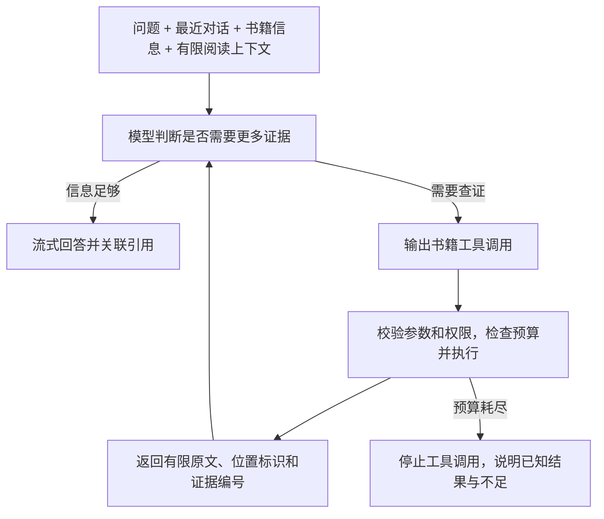

# AI Agent 工具调用与书籍检索调研

调研日期：2026-10-25。本文保留初次源码核对与实施建议；后续已按批准的 Pi 方案实现迁移，见 [集成记录](./pi-agent-integration.md)。

> 后续选型更新：根据“商用许可友好、长期直接复用 Harness”的要求，建议采用 Pi Durable + Cloudflare 官方 PiHarness，详见 [Harness 选型记录](./agent-harness-selection.md)。下文保留初次调研；其中工具、检索和引用设计仍适用，自行维护工具循环的实施方向已被新选型取代。

核心建议：将当前固定的 RAG 流水线改为有预算上限的工具调用循环。模型根据问题、对话上下文和工具结果决定是否继续查证；Embedding 作为书籍搜索工具内部的一种检索方法。保留已有 D1、Vectorize、引用定位和 AI 用量记录。

## 1. 必须区分的三件事

| 问题 | 负责机制 | 是否必然需要 Embedding |
| --- | --- | --- |
| 现在应该调用哪个工具？ | 模型读取工具名称、描述、参数 schema 和对话后，生成 tool call | 否 |
| 工具很多时，应该给模型加载哪些工具定义？ | 工具发现，例如搜索工具名称与描述 | 否；Pi 当前实现使用 BM25 |
| 书里哪些段落与问题相关？ | 内容检索，可采用语义、字面或混合搜索 | 语义检索通常需要；目录查询、按位置读原文不需要 |

因此，“Agent 自己决定是否检索”不等于“模型自己执行 Embedding”。模型请求 `search_book`；服务端校验并执行该工具，再由搜索实现选择底层检索方式。

书籍入库时生成段落向量，与提问时生成查询向量也是两条流程。一次搜索不需要重新向量化整本书。

## 2. 四个项目的实际做法

以下结论限定于本次检查的源码与公开文档，不能据此断言某个项目的全部插件或内部服务都不使用向量搜索。

### Pi Agent

原 `badlogic/pi-mono` 仓库目前重定向至 `earendil-works/pi`。本次源码快照：`38ff99177fba21e9c57a670f4e95adcf407c99c7`。

- 核心循环接收模型输出，提取工具调用，校验参数并执行，将工具结果追加到消息中，再调用模型。没有工具调用时可结束这一轮；取消和错误也有明确处理。
- `beforeToolCall` 等钩子可以阻止执行；上下文处理和消息转换与工具执行分开。
- 默认 coding tools 是 `read/bash/edit/write`；另有 `grep/find/ls`，支持按需寻找和读取文件，并非固定每轮先做向量检索。
- 可选 `tool_search` 扩展对工具元数据做 BM25 排序，并激活匹配工具。源码把 Embedding 混合排序写作未来可替换方案，不能当成已实现功能。

参考：[核心循环](https://github.com/earendil-works/pi/blob/38ff99177fba21e9c57a670f4e95adcf407c99c7/packages/agent/src/agent-loop.ts)、[工具集合](https://github.com/earendil-works/pi/blob/38ff99177fba21e9c57a670f4e95adcf407c99c7/packages/coding-agent/src/core/tools/index.ts)、[BM25 工具发现](https://github.com/earendil-works/pi/blob/38ff99177fba21e9c57a670f4e95adcf407c99c7/packages/coding-agent/src/extensions/tool-search/tool.ts)。

适合借鉴：小而清晰的循环、明确的工具契约、可观察的调用事件。我们的首版只有少量书籍工具，无需引入工具发现机制。

### DeepSeek Harness

仓库：`deepseek-ai/deepseek-harness`。本次源码快照：`22ddee3792402c3e70ec5f86a63c3e3e895a2f60`。

- 基于插件组合 agent loop、模型、会话和工具。一个 turn 可以包含多个模型调用及工具执行 step。
- 先解析当前可用工具，随后组装 prompt；模型返回工具调用后，经过统一的校验、守卫及执行流程，结果回写会话，再进入下一步。
- 默认文件搜索包提供基于 ripgrep 的 `glob/grep`。搜索返回有限预览，较大结果可保留为后续读取的产物，避免一次塞满上下文。
- Memory 文档明确将外部记忆存储和 Embedding 配置交给对应 provider；Harness 本身不替用户选择 Embedding 服务。参考记忆 provider 的检索也不能等同于语义搜索。

参考：[架构](https://github.com/deepseek-ai/deepseek-harness/blob/22ddee3792402c3e70ec5f86a63c3e3e895a2f60/docs/architecture.md)、[工具执行管线](https://github.com/deepseek-ai/deepseek-harness/blob/22ddee3792402c3e70ec5f86a63c3e3e895a2f60/docs/tool-execution-pipeline.md)、[文件搜索](https://github.com/deepseek-ai/deepseek-harness/blob/22ddee3792402c3e70ec5f86a63c3e3e895a2f60/packages/fs/tool-fs-search/README.md)、[记忆集成边界](https://github.com/deepseek-ai/deepseek-harness/blob/22ddee3792402c3e70ec5f86a63c3e3e895a2f60/docs/user/guide/mcp-memory.md)。

适合借鉴：工具执行统一入口、会话事件、输出长度限制，以及“先发现位置，再按需读详细内容”的检索方式。使用 DeepSeek 模型不代表必须采用整个 DeepSeek Harness。

### OpenCode

仓库：`anomalyco/opencode`。本次源码快照：`ddd9e103fe082dcb24aaf8682d7e79eb9b0dce50`，检查的是当前 `packages/core` 结构。

- 模型请求与工具执行形成循环，工具调用经过权限处理，结果截断后回传；会话包含工具执行状态及模型用量。
- 提供 `grep/glob/read` 等按需代码检索工具，`grep` 使用 ripgrep 返回文件、行号及预览。
- 支持配置 `agent.steps`。达到上限时保留工具定义，但设置 `toolChoice: "none"`，要求模型结束并说明结果或限制。
- 有上下文压缩处理；“何时结束、如何收敛”是执行框架职责，不能只靠 prompt 让模型自觉停止。

参考：[模型循环及步数控制](https://github.com/anomalyco/opencode/blob/ddd9e103fe082dcb24aaf8682d7e79eb9b0dce50/packages/core/src/session/runner/llm.ts)、[工具执行](https://github.com/anomalyco/opencode/blob/ddd9e103fe082dcb24aaf8682d7e79eb9b0dce50/packages/core/src/session/runner/step.ts)、[grep 工具](https://github.com/anomalyco/opencode/blob/ddd9e103fe082dcb24aaf8682d7e79eb9b0dce50/packages/core/src/tool/plugin/grep.ts)。

适合借鉴：明确的结束条件、取消传播、输出截断和逐次用量记录。

### Claude Code

Claude Code 核心并不像前三者那样开源。公开仓库采用保留所有权利的商业条款，本节依据官方架构和 SDK 文档，不声称检查过其内部核心源码。[仓库许可](https://github.com/anthropics/claude-code/blob/main/LICENSE.md)

- 官方文档描述模型根据上下文选择工具，执行后读取结果，并循环完成任务；SDK 提供轮数和预算限制。
- 官方上下文工程文章介绍按需探索：保留文件路径等轻量位置标识，借助搜索和读取工具取得需要的上下文，同时可预加载部分重要信息。
- 工具发现是为大量工具定义服务的另一层机制。官方 SDK 文档指出，小工具集合通常直接提供定义更合适；额外发现步骤也会增加往返延迟。

参考：[工作机制](https://code.claude.com/docs/en/how-claude-code-works)、[SDK 工具循环](https://code.claude.com/docs/en/agent-sdk/agent-loop)、[工具发现](https://code.claude.com/docs/en/agent-sdk/tool-search)、[上下文工程文章，2025-09-29](https://www.anthropic.com/research/effective-context-engineering-for-ai-agents)。

适合借鉴：按需补充证据、有限上下文、预算控制。公开文档不足以支持“Claude Code 内部任何地方都不使用 Embedding”的结论。

## 3. Infinite Reader 当前的差距

已核对当前工作区代码：

1. [ask.ts](/path/to/infinite_reader/worker/src/routes/ask.ts:67)：书籍处于 `ready/indexing` 时，每次提问都尝试 `retrieveChunks`。检索 query 为当前问题与最多 600 字符选文的拼接。
2. [rag.ts](/path/to/infinite_reader/worker/src/rag.ts:16)：查询文本截取前 2000 字符做 Embedding，再按书籍 namespace 查询 Vectorize，默认取 6 个片段并从 D1 取回原文。当前没有检索后继续改写查询的循环。
3. [ask.ts](/path/to/infinite_reader/worker/src/routes/ask.ts:81)：最近 6 条历史消息在检索之后才读取；最终回答能看到这些历史，但检索 query 不使用它们来消解“他”“刚才那个事件”等指代。
4. [ask.ts](/path/to/infinite_reader/worker/src/routes/ask.ts:113)：模型请求没有传入 `tools`，流解析也没有组装 `tool_calls`。因此当前服务端是固定 RAG 加一次生成，而不是模型按需调用检索工具。
5. [AskPanel.tsx](/path/to/infinite_reader/web/src/ui/AskPanel.tsx:80)：没有选文时，请求只有书籍、问题和会话标识，没有自动附上当前可见页的内容或位置。“解释这一页”不能假定模型已经看到了这一页。

已有基础可以保留：书籍及用户权限检查、D1 片段和目录、Vectorize、引用定位、流式输出、取消处理以及 [AI usage ledger](/path/to/infinite_reader/docs/ai-usage.md)。

## 4. 建议的首版设计

不先增加独立的意图分类模型，也不主要依靠关键词 if/else 分流。模型在同一次协议中可以直接回答，也可以输出工具调用；服务端负责验证和限制实际执行。

| 工具 | 用途 | Embedding |
| --- | --- | --- |
| `get_book_outline` | 取得目录、章节标识和结构；规划跨章节查阅 | 不需要 |
| `search_book` | 根据概念、人物或事件寻找证据；首版复用现有语义搜索 | 语义搜索时需要 |
| `read_book_passage` | 按片段或章节位置读取原文及邻近上下文，支持有限长度和续读位置 | 不需要 |

三个工具的 schema 直接提供给模型。`bookId/userId` 从已授权的请求上下文注入，不允许模型用工具参数访问任意用户的数据。

预期行为举例：

- “把选中的这句话翻译成英文”：选文完整且不需额外背景时直接回答，不搜索全书。
- “作者在其他章节是否反驳过这个观点”：调用搜索，必要时读取相邻原文，再回答。
- “他后来为何改变立场”：结合历史明确“他”是谁，再构造检索 query；指代仍不明确时澄清。
- “第三章与第七章有什么不同”：先取得章节位置，再分段读取两章，不能把全书相似度最高的 6 个片段当作完整章节。
- “解释当前这一页”：请求需要携带阅读位置，服务端据此读取或核实有限原文；不能只凭 `bookId` 猜测。

首轮可评估“最多 3 批工具调用，再进行一次最终生成”，并另设工具总数、总耗时、输入输出及重试预算。这是待验证的初始配置，不是调研证明的最优值。预算耗尽或取消后不得继续发起付费请求。

代码搜索常有明确文件名和符号，书籍提问则常使用概括、同义表达和跨章节语义。因此应保留语义检索；精确人名、引文的字面搜索或混合召回，可在评测发现不足后补充到同一个 `search_book` 工具。不要直接把代码仓库的 grep 方案照搬成全部书籍检索。

## 5. 实施时不能遗漏的边界

- **模型协议**：流式拼接工具名称与 JSON 参数，等完整调用到达并校验成功后再执行。保留实际 assistant/tool 消息及 `tool_call_id` 配对。DeepSeek 开启思考模式时，需要按对应模型协议保存和回传所需的 `reasoning_content`；它是协议状态，不应作为检索证据。实施前对实际配置的模型和网关做契约测试，不能只按另一家 OpenAI-compatible 服务的行为推断。[DeepSeek 工具调用](https://api-docs.deepseek.com/guides/tool_calls/)、[思考模式](https://api-docs.deepseek.com/guides/thinking_mode/)
- **会话与上下文**：当前只重新读取 `role/content` 不足以重建工具交互。需要结构化调用记录或可重建的证据引用，同时限制历史长度；不把整本书或所有工具结果无限累计进 prompt。
- **引用**：服务端为本轮实际读到的片段分配稳定编号，多次检索后不能重新编号覆盖旧来源。回答引用只能解析到本轮有效证据，点击仍能回到书中位置。
- **用量**：一次用户问题使用同一 `operation_id`；每次模型请求和 Embedding 请求分别记账，包括工具选择、后续生成、重试、失败和取消。沿用未知 token 为 NULL 的规则，不能当作零成本。工具耗时和成功率另记执行事件，不能靠 token 表推断完整调用过程。
- **执行边界**：首版仅暴露读书工具；限定长度、章节范围和参数 schema，执行前复核权限。书中内容和工具返回文本是证据，不是能覆盖系统指令的命令。不要将原始 SQL 或通用 shell 暴露给阅读 Agent。
- **结果质量**：工具返回空结果、错误或不充分证据时允许改写查询或补读，但总量受预算约束。同一轮完全相同的请求可复用结果。检索得分不是事实正确性的保证，也不存在未经评测即可通用的相似度阈值。
- **费用与延迟**：简单问题可少一次 Embedding；复杂问题可能多次调用语言模型。不能承诺这种设计必然更省钱，应该按完整用户轮次比较效果、耗时和实际用量。

## 6. 验收与推进顺序

| 场景 | 要验证的结果 |
| --- | --- |
| 简单致谢、完整选文翻译 | 不进行无必要的全书搜索 |
| 跨章节事实问题 | 调用搜索，引用确实支持结论 |
| 连续追问中包含代词 | 利用历史明确查询对象，必要时澄清 |
| 查询仅召回前言或版权页 | 能补充检索或承认证据不足，不把片段当全书观点 |
| 全章、全书总结 | 有目录和内容覆盖策略；预算不足时说明覆盖范围 |
| 精确名字、原句查询 | 评估语义检索漏召回，决定是否需要字面或混合检索 |
| 工具参数错误、无结果、超时 | 有限恢复，不出现无限重试 |
| 中断与预算耗尽 | 取消向下传播，不再启动新的模型调用 |
| 多次检索后的角标 | 编号稳定，能打开对应章节与原文位置 |
| 每轮费用统计 | 所有实际模型尝试与 Embedding 调用均可关联，缺失用量明确标识 |

建议先实现三个工具及有界循环，复用已有索引和用量系统，以现有固定 RAG 为基线评测中文书籍问答。再根据工具轨迹和失败案例调整搜索、上下文和预算。

当前没有必要引入多 Agent、庞大的 MCP 工具目录或整套 coding harness。Pi 的核心循环值得进一步评估复用，但本次尚未验证其在 Cloudflare Workers 中的依赖、包体与运行兼容性，不能直接认定可无成本接入。

本次结论来自源码和公开文档分析；未运行四个 Harness 的统一性能测试，也未对生产模型发起付费对比测试。
