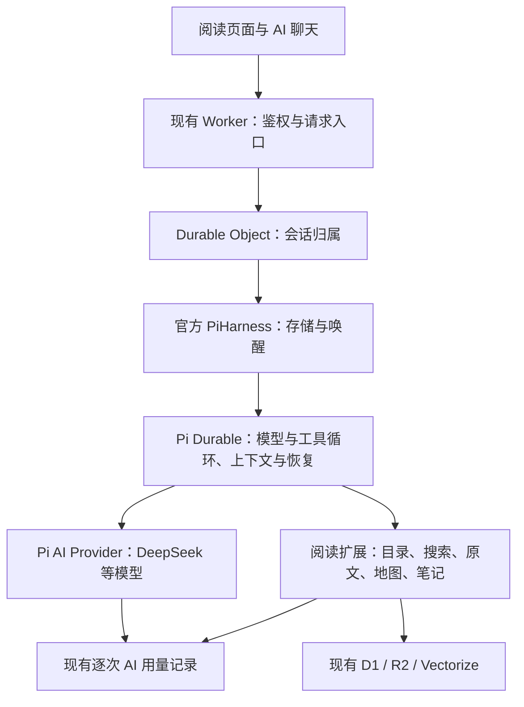

# Infinite Reader Agent Harness 选型

调研日期：2026-10-25。本文保留选型时的依据与隔离验证记录。后续已按用户批准实现迁移，当前实现与验收状态见 [Pi Agent 集成记录](./pi-agent-integration.md)。

## 决策建议

选择 **Pi Durable 作为 Agent Harness，通过 Cloudflare Agents SDK 的官方 PiHarness 运行在 Durable Objects 上**。

将上游软件包作为依赖直接使用，按其扩展接口接入阅读工具。此前“参考 Pi 实现一个小循环”的建议不足以满足长期复用要求，不再作为实施方向。本文取代 [前一轮调研](./agent-harness-retrieval-research.md) 中关于自行维护执行循环的实施建议；书籍工具、检索与引用设计仍然适用。

选择依据是当前产品与运行环境的适配度：Infinite Reader 是嵌入阅读页面的领域 Agent，已经使用 TypeScript、Workers、D1、R2 和 Vectorize，需要可组合的阅读工具、模型切换、上下文管理及持久会话。Pi Durable 提供完整执行内核，Cloudflare 提供现成的宿主适配。它仍然存在明确的成熟度风险，不能把本地试跑通过等同于生产接入完成。

## 核对的版本与许可证

| 项目 | 本次核对对象 | 许可 / 状态 |
| --- | --- | --- |
| Pi | `earendil-works/pi`，源码 `d5b3de22d0e24a3e9c38a9410d3329b099717283`；Pi 包 `1.4.0` | MIT；`pi-durable` 明确标注 Experimental |
| Cloudflare Agents SDK | 源码 `321814b6c13f72cff82161e7eb20312574ac9b7a`；`agents@0.30.1` | MIT；PiHarness 文档标注 Beta |
| OpenCode | `anomalyco/opencode`；官方 Workerd SDK 与 Cloudflare 适配文档 | MIT；未做本地对比试跑 |
| DeepSeek Harness | 根包 `0.2.1-rc.3`；官方 README、架构与许可证 | MIT；Developer Preview，声明存在破坏性更新 |
| Claude Code | 官方仓库许可证与公开文档 | 核心为专有商业软件，不符合本次开源内核要求 |
| LangGraph.js | 官方仓库许可证与架构文档 | MIT；作为复杂工作流方向的补充候选，未做 Workers 接入验证 |

MIT 允许商业使用、修改和分发；保留所要求的版权和许可声明，不要求将自有应用代码开源。该判断针对已核对的组件，模型服务条款、云服务费用及新增依赖需要分别处理。

依据：[Pi LICENSE](https://github.com/earendil-works/pi/blob/d5b3de22d0e24a3e9c38a9410d3329b099717283/LICENSE)、[Agents SDK LICENSE](https://github.com/cloudflare/agents/blob/321814b6c13f72cff82161e7eb20312574ac9b7a/LICENSE)、[OpenCode LICENSE](https://github.com/anomalyco/opencode/blob/dev/LICENSE)、[DeepSeek Harness LICENSE](https://github.com/deepseek-ai/deepseek-harness/blob/main/LICENSE)、[Claude Code LICENSE](https://github.com/anthropics/claude-code/blob/main/LICENSE.md)、[LangGraph.js LICENSE](https://github.com/langchain-ai/langgraphjs/blob/main/LICENSE)、[MIT 条款](https://opensource.org/license/mit)。

## 为什么是这套组合

### 1. 复用执行内核，而非只借鉴工具循环

需要区分 Pi 的包：

- `pi-ai`：模型访问与协议抽象。
- `pi-agent-core`：基础 Agent 循环；仅引入它仍然需要自行承担较多持久化工作。
- `pi-durable`：持久会话、工具任务、重试、恢复、上下文压缩、扩展和子会话等 Harness 能力。
- `pi-coding-agent`：面向编程的 CLI/SDK；此次不搬入其整套产品交互。

建议依赖的是 `pi-durable`。自动上下文压缩、取消传播、重试和会话恢复不再作为 Infinite Reader 自己维护的执行框架。阅读工具以扩展注册；书籍问答所需的工具集合和规则仍由产品决定。[Pi Durable 文档与接口](https://github.com/earendil-works/pi/blob/d5b3de22d0e24a3e9c38a9410d3329b099717283/packages/durable/README.md)

### 2. 已有官方 Cloudflare 适配

`agents/harness/pi` 为 Pi 接上 Durable Object SQLite 存储及 Lifecycle 唤醒机制。Pi 负责执行语义，Cloudflare 适配负责运行环境，这两层职责明确。前端通信协议需要与现有聊天 UI 接起来，可参考官方完整示例。

当前 `agents` 支持 Pi `~1.4.0`。两边都需要锁定经过验证的具体版本，再成组升级。[官方 PiHarness 文档](https://developers.cloudflare.com/agents/harnesses/pi/)

### 3. 适合领域工具逐步增加

首先接入 `get_book_outline`、`search_book`、`read_book_passage`。以后导航、笔记、地图与外部资料查询可以继续作为工具或扩展加入，执行循环由同一个上游 Harness 维护。

Pi 提供扩展和子会话原语，Cloudflare 有 Skills 等适配，Pi 另有 MCP 客户端。它们提供复用路径，但需要逐个验证实际运行环境；CLI 扩展、stdio MCP 或本地 shell 工具不能直接假定能在 Workers 上运行。[Cloudflare Pi 扩展](https://developers.cloudflare.com/agents/harnesses/pi/extensions/)、[Pi MCP](https://github.com/earendil-works/pi/blob/d5b3de22d0e24a3e9c38a9410d3329b099717283/packages/mcp/README.md)

## 其他候选的取舍

### OpenCode：最强备选，不能以 Workers 不兼容排除

OpenCode 已有 `@opencode/sdk/workerd` 和 Cloudflare 官方 `OpenCodeHarness`，可以嵌入 Durable Object；无需先假设要增加独立 Node 服务。它的自定义工具、Agent、Skills、MCP、会话和事件能力值得直接复用。[OpenCode Workerd SDK](https://opencode.ai/v2/docs/build/sdk/cloudflare/)、[Cloudflare OpenCodeHarness](https://developers.cloudflare.com/agents/harnesses/opencode/)

它还提供现成的权限申请/回复事件、待审批状态，以及持久事件回放。这些是实际优势。Pi 的 `beforeTool` 阻止执行钩子不能等同于完整的持久人工审批流程。[适配接口中的权限与事件类型](https://github.com/cloudflare/agents/blob/321814b6c13f72cff82161e7eb20312574ac9b7a/packages/agents/src/harness/opencode/types.ts)

本次仍优先 Pi，是因为它允许我们直接组织阅读领域的工具和会话，较少依赖编程助手的默认行为。OpenCode 也能定制，但官方 Workers 示例需要移除默认的本地文件和 shell 工具。这里是产品适配判断，没有做包体、性能或成熟度的统一基准测试，不能声称 Pi 在这些指标上优于 OpenCode。

如果下一阶段的核心需求已经明确变成频繁的写操作审批、复杂权限交互和可回放任务控制台，应重新比较 OpenCode 的现成能力，避免在 Pi 旁边又实现一整套审批框架。

### DeepSeek Harness

插件结构有吸引力，MIT 也满足许可要求。但当前为 Developer Preview；主项目 Node.js 要求为 `>=24.9.0`，包含本地系统相关模块。本次未找到并验证与上述两者相当的官方 Workers 嵌入路径，因此当前接入风险更高。使用 DeepSeek 模型与采用 DeepSeek Harness 是独立决策。[官方 README](https://github.com/deepseek-ai/deepseek-harness/blob/main/README.md)、[运行要求](https://github.com/deepseek-ai/deepseek-harness/blob/main/package.json)

### Claude Code

其核心不是符合本次要求的开源内核。开放 SDK 或公共仓库的存在，不改变核心运行时的许可边界，因此不选作自有产品的开源 Harness 基础。[许可证](https://github.com/anthropics/claude-code/blob/main/LICENSE.md)

### LangGraph / Deep Agents 方向

LangGraph 侧重持久编排；Deep Agents 是其生态中的更完整 Harness。它们对显式工作流、人工介入和复杂多 Agent 流程有价值。本次仅核对了 LangGraph.js 的 MIT 许可和官方架构文档，未完成 Deep Agents 的具体版本、依赖和 Workers 适配评估，不将这一组合当作已经验证的即插即用方案。[官方架构定位](https://docs.langchain.com/oss/javascript/langgraph/overview)

## 与现有项目的职责划分

| 交给上游复用 | Infinite Reader 保留的业务职责 |
| --- | --- |
| 模型/工具往返、参数验证、执行状态 | 当前用户与书籍的授权、工具输入输出契约 |
| 会话、任务持久化及恢复机制 | 会话归属、阅读位置、引用编号与点击定位 |
| 上下文压缩、模型重试与取消原语 | 每轮预算、总耗时和允许使用的工具策略 |
| 扩展、子会话、MCP/Skills 接入路径 | 书籍检索质量、笔记/地图业务、前端呈现 |
| 上游 token / cost 信息 | 所有 AI 请求的统一审计账本，包括框架内部调用 |

具体边界：

- 模型通过 `search_book` 发起检索；该工具内部继续使用既有 Embedding 和 Vectorize。Harness 不会自动替换书籍索引或定义最合适的检索策略。
- `userId/bookId` 由已授权上下文注入，不能由模型决定访问范围。
- DO 保存执行会话和任务。D1、R2、Vectorize 继续承担业务数据；避免在 D1 与 DO 建立两套相互竞争的会话真相。引入 DO 是新增运行资源，有相应的迁移和费用评估工作。
- Pi 的汇总 usage 不能直接代替我们要求的逐次调用账本。模型 provider/调用边界需要接入现有记录，覆盖重试、压缩、失败和取消；Embedding 与地图识别也继续记录。缺失 token 仍记未知，不能改为零。
- 请求去重不意味着外部写操作只执行一次。可重放工具仍须为实际副作用设计幂等键与授权规则。
- 现有前端只依赖应用定义的少量消息/工具/引用事件；把 Pi 类型与存储细节限制在服务端适配模块，避免上游 API 更新扩散到阅读器。

## 本次本地验证

在仓库外建立 `/tmp/infinite-reader-harness-eval.TTJYCl`，使用模拟模型及虚构书籍工具，没有接入真实模型、账号或生产书籍。

环境：Node.js `22.22.1`、现有 Wrangler `4.150.0`，本地 Workerd，`nodejs_compat`，SQLite Durable Object。依赖固定为 `agents@0.30.1`、`pi-durable/pi-ai/chord@1.4.0`；安装时使用 `--ignore-scripts --legacy-peer-deps`，随后以 `npm ls` 核对上述四个包及其去重关系。完整依赖治理留待正式接入。

| 验证项 | 实际结果 |
| --- | --- |
| 在本地 Worker 中加载 PiHarness | 成功启动并处理 HTTP 请求 |
| 模拟模型直接回答 | 未执行书籍工具 |
| 模拟模型请求 `search_book` | 执行一次，结果回给模型并生成最终回答 |
| 相同 `operationId` 再提交 | `accepted: false`，未重复执行工具 |
| 工具已开始后显式取消 | 返回 `unanswered / aborted`，待处理队列清空 |
| 停止并重启本地 Worker | 13 条会话记录及汇总 usage 与重启前一致 |
| 重启后重交已完成请求 | 返回原结果，未再次执行工具 |

证据文件：临时工程的 `src/index.ts`、`before-restart.json`、`after-restart.json`。本地服务已停止。

这些结果证明基础嵌入和持久化链路可运行。模拟模型按脚本选择工具，不能证明真实模型能正确判断何时检索；模拟 usage 也不能验证 DeepSeek 的真实计量。未验证运行中崩溃恢复、真实流式模型协议、长上下文压缩、MCP、云端驱逐恢复或生产负载。

## 正式接入的门槛

1. 锁定版本，使用上游依赖和官方适配，不 fork 执行内核；只为产品协议和工具做小范围适配。
2. 对实际 DeepSeek 模型验证流式 tool calls、思考模式状态、错误/重试/取消及逐次 token 记录。
3. 在现有三种阅读工具上验证直接回答、连续追问、多次检索、长上下文和引用定位；与当前固定 RAG 比较质量、延迟和完整轮次成本。
4. 验证 DO 重启/驱逐恢复、授权隔离、请求去重与副作用幂等。初期使用读工具，避免把“可恢复”误当作任意工具可安全重放。
5. 通过后逐步切换聊天入口，保留明确的回退路径。后续每次升级以行为回归和模型契约测试为准。

主要风险是 **Pi Durable Experimental + PiHarness Beta**。选择它意味着接受受控的版本维护工作；当前证据支持将其作为优先接入方案，不支持声称它已经达到生产验收或会自动满足所有未来 Agent 需求。
