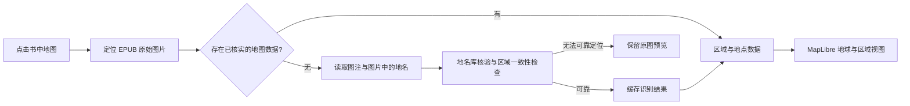

# 书中地图的 3D 地理视图：研究与实现建议

研究日期：2026-10-23。本文记录原始研究方案；2026-10-24 的首版实现范围与验收见 [book-map-atlas-v1.md](./book-map-atlas-v1.md)。通用视觉识别及原图地理配准仍未实现。

## 结论与范围

可以实现“点击书中地图 → 打开地球 → 聚焦对应区域 → 查看图中地点”。当前阅读器已经保存 EPUB 原图及图片在页面内的位置，参考项目已经实现球面地图、区域聚焦、地点图层及地形展示。

需要分别实现并验证三个层次：

| 能力 | 用户看到的效果 | 主要工作 |
| --- | --- | --- |
| 区域定位与地点展示 | 点击“西欧，1940 年”，镜头聚焦西欧，显示经过核实的图中地点 | 图片识别、范围判断、地名消歧、地图视图接入 |
| 历史原图叠加 | 原图中的海岸线、城市位置与地理底图对齐，可调整透明度 | 控制点匹配、投影/变形校正、误差检验 |
| 历史要素重建 | 国界、占领区、行军路线成为可交互矢量图层 | 经核实的历史资料、要素提取及时间语义；单独规划 |

建议先交付第一个层次。区域定位结果不应被描述为原图已精确配准。

## 参考仓库中实际可借鉴的实现

审阅了 `book-space-time` 的 README、MapLibre 渲染器与数据转换、Cesium 归档说明、EPUB 解析及地点解析路径。本地检出的提交为 `db9266411f4930ce02b6ac46a6f08ba9787a68e8`；另外通过 GitHub 读取当前 main 的前端 package.json 与地图渲染器，确认这两个文件与本地内容的 Git blob SHA 相同。

- 活跃渲染器为 **MapLibre GL JS**，依赖声明为 `^5.24.0`。使用 `projection: { type: 'globe' }`；Cesium 已归档。
- 使用栅格浮雕底图、Terrarium DEM 高程数据和 GeoJSON 地点图层；真实地形通过 `setTerrain` 开关启用，默认关闭。
- `fitBounds` 展示区域，`easeTo` 聚焦具体地点；球面和 Mercator 投影可切换。
- `ImageSource` 已用于展示具有已知地理范围的浮雕图片。它是地理图层的展示能力，不包含识别任意历史地图和计算配准的流程。
- 地点解析利用文本上下文和地名库候选，并在输出中保留置信度、精度和证据关联。已审阅的 EPUB 解析路径提取文字与图注，未发现地图图片 OCR/配准流水线。

主要源码：[渲染与图层](https://github.com/book-space-time/blob/main/apps/web/components/maplibre-dem-globe.tsx#L336)、[镜头与地形](https://github.com/book-space-time/blob/main/apps/web/components/maplibre-dem-globe.tsx#L638)、[GeoJSON 转换](https://github.com/book-space-time/blob/main/apps/web/lib/maplibre-atlas-data.ts#L85)、[地点模型](https://github.com/book-space-time/blob/main/apps/api/src/book_space_time/domain/extraction.py#L178)、[Cesium 归档说明](https://github.com/book-space-time/blob/main/apps/web/archive/cesium/README.md)。

复用时要调整的部分：

- 参考项目的高细节区域浮雕瓦片主要覆盖亚洲，初始镜头也针对特定区域；需要选择覆盖西欧、巴尔干及后续目标地区的底图，并检查清晰度与数据署名。
- `buildChapterAreaCollection` 生成地点的外接矩形，不能当作历史疆域。
- `buildChapterRouteCollection` 按地点顺序连线，不能据此认定真实行军路线。
- 复用渲染和数据组织思路即可；当前功能不需要移植整个 Next.js + Python 后端。

## 推荐的阅读体验

以用户提供的图片为首批验收样本：

- 左图“地图 1 西欧，1940 年”：打开后聚焦原图覆盖的西欧范围，保留标题和年代。图中伦敦、巴黎、柏林等地点，经核实后可显示为标记。
- 右图“地图 2 巴尔干地区，1940—1941 年”：聚焦巴尔干及图中周边区域，显示经核实的贝尔格莱德、索非亚、雅典等地点。

建议在阅读器内打开大幅地图浮层：主体为交互地图，旁边保留可展开的原图。进入时用一次简短的镜头过渡建立“全球 → 所读区域”的空间关系；之后允许旋转、缩放，选择地点时展示原图名称与对应地名。尊重减少动态效果设置。

地图标题和年代直接来自原图或经过核实的图注。初版以自然地形为底图，默认不叠加现代政治国界，避免将其误认为 1940 年的边界。历史国名保留原文；若展示现代地名，明确两者关系。关闭视图后恢复原来的阅读位置、缩放和倾角。

已经识别的地图可在悬停时显示低调的“查看地图”入口，并支持键盘操作。未识别图片先展示原图预览和明确的定位状态；定位失败仍可阅读原图。不能把所有插图都当成地图，也不能在识别失败后跳到任意默认地区。

## 数据与处理链路

识别输入使用 `ParsedBook.getImage(path)` 返回的原始图片，附带图片 alt、图注和少量邻近文字。书页截图经过了透视、曲面、纸色和光照处理，不适合作为主要识别输入。

视觉/OCR 负责判断是否为地图，读取图名、年份、地名以及它们在图中的位置；地名库负责核验坐标和实体。结合图名、其他地名、年代和周边文字排除同名地点。国家、城市、区域分别建模，避免把国家首都坐标当作整个国家的范围。AI 推测的坐标不应未经核验直接作为精确位置展示。

最小地图数据需要包含：

- 图片身份：书籍版本、图片内容哈希、EPUB 资源路径；图片出现位置另存章节 href 和稳定的块/出现序号。
- 来源与范围：原始图名、年代文字、区域范围及其依据、整体定位状态。
- 地点：原图名称、对应实体、经纬度或范围、来源、置信度；可选的图中像素锚点供原图联动使用。
- 缓存版本：识别器版本，以及人工核实状态。相同图片在不同章节出现时，图注与年代判断仍需区分上下文。

页码只作为显示信息。图片身份和地理数据不依赖重排后的页码，避免改变字号、窗口大小或分页算法后关联失效。

当前 Worker 已有 R2、D1、Queue 与 Workers AI binding，能够承接后续的原图读取、任务调度与结果缓存。当前 AI 调用主要用于文本嵌入和问答，图片理解需要单独接入并评估。Cloudflare 官方提供视觉模型调用方式，但这不等于该账户已启用指定模型，也不证明其对本书小字、旧译名的识别效果。[官方视觉模型教程](https://developers.cloudflare.com/workers-ai/guides/tutorials/llama-vision-tutorial/)

首个验证版本可直接加载两张地图经过核实的数据，验证交互；随后再增加自动分析。自动分析按需触发，复用正在执行的任务并缓存结果，避免每次点击重新调用模型。后台原图和分析结果沿用书籍访问权限。

## 当前阅读器的具体接入点

| 位置 | 已有能力 | 建议变更 |
| --- | --- | --- |
| `web/src/book/types.ts` | 图片资源路径、alt、原图读取 | 保留图片出现位置的稳定身份 |
| `web/src/book/layout.ts` | `PlacedImage` 的页面坐标和尺寸 | 将图片身份带入排版结果 |
| `web/src/engine/scene.ts` | 指针手势、Three.js 射线检测、SceneHooks | 在真实点击结束时命中可见页上的图片，发出图片事件 |
| `web/src/ui/DeskView.tsx` | 场景与 React 状态连接 | 打开按需加载的地图视图 |
| 新增地图视图模块 | — | MapLibre 初始化、图层、镜头、关闭与资源清理 |
| 后续 Worker 地图分析模块 | 原始 EPUB 存在 R2，普通内文图片尚未单独索引 | 按目标资源读取图片、分析、保存结果 |

点击命中建议使用“屏幕指针 → 可见纸张网格 → UV → 页面坐标 → 图片矩形”的路径。需要复用实际曲面和正反面映射，并剔除被覆盖的页面；只按平面 DOM 矩形判断会在倾斜视角下产生偏差。

只有未构成拖动、选择或翻页的真实点击才打开地图；翻页动画期间不接受图片点击。弹层打开后隔离书籍键盘、滚轮、触摸缩放和页边悬停操作。地图模块按需加载，关闭时销毁 MapLibre 实例；地图全屏展示期间让背景书籍停止无用渲染。

这使书籍物理渲染、地图展示和图片分析分别负责自己的工作，同时复用现有的图片解析和交互基础。

## 历史原图叠加的后续路线

要使原图海岸线真正对齐，需要将图中像素与真实经纬度建立对应关系。处理步骤为：裁出地图有效区域，选择分布均匀的城市点或海岸特征作为控制点，估计变换，剔除错误匹配，再用未参与拟合的点检查误差。图中文字的位置不一定就是城市符号的位置，配准锚点必须对应真实地理符号。

无法仅凭“这张图是西欧”推导每个像素的经纬度。简单四角贴图可能看起来接近，内部仍会错位；历史地图也可能使用与底图不同的投影或包含局部插图。通过核验的校正结果再交给 `ImageSource` 或栅格瓦片展示，并提供透明度调节。

[MapLibre ImageSource](https://maplibre.org/maplibre-gl-js/docs/API/classes/ImageSource/) 接受图像角点的地理坐标；[GDAL gdalwarp](https://gdal.org/en/stable/programs/gdalwarp.html) 提供控制点和重投影处理。当前 MapLibre 文档中的实验性 `setWarp` 也不负责自动识别地理控制点，首版无需依赖它。

对这两张固定样本，可以先离线人工校准并生成成果；泛化自动校准作为后续处理任务。若采用 GDAL，其计算应放在支持该运行时的预处理环境，Cloudflare Worker 负责调度和分发成果，不假设现有 Worker 可直接执行原生 GDAL。

校准误差超出该地图比例尺和展示用途允许的范围时，继续使用原图并排对照。历史疆域和战争路线需另有来源依据；图片叠加不会自动产生可靠的历史矢量数据库。

## 推荐的实施顺序与验收

1. **两图交互原型**：以图片身份绑定已核实的范围与地点，完成左右页图片点击、地球聚焦、原图对照、关闭恢复；验证读书过程不受影响。
2. **通用识别**：加入图像分类、图注/OCR、地名消歧、异步状态及缓存；用不同书籍的地图和非地图图片评估误判、定位失败率、延迟与成本。
3. **经过校准的原图叠加**：先离线校准样本，验证对齐误差，再考虑自动控制点匹配。动态历史边界与事件路线另行规划。

验收重点：

- 左右页、不同缩放和倾角均能准确命中地图；划线、拖动、翻页不会误打开。
- 两个样本聚焦各自正确范围，地点有来源；不会把现代国家边界标成历史边界。
- 地图缩放不会同时缩放书籍或浏览器；关闭后阅读状态保持。
- 首次分析、重复点击、网络失败、非地图、模糊地名都有明确结果；低置信度时不伪装成精确定位。
- 连续打开关闭无 WebGL 实例泄漏，地图库不进入阅读器首屏的必需加载路径。
- 原图叠加单独检验控制点误差，不能以“镜头飞到了欧洲”替代配准验收。

本研究未调用生产视觉模型、未执行图片自动配准，也未测得实际耗时或识别准确率；这些是原型阶段需要验证的项目。
